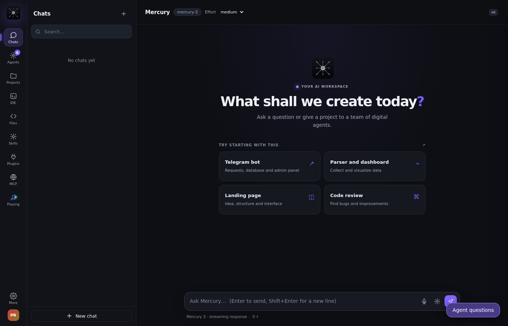
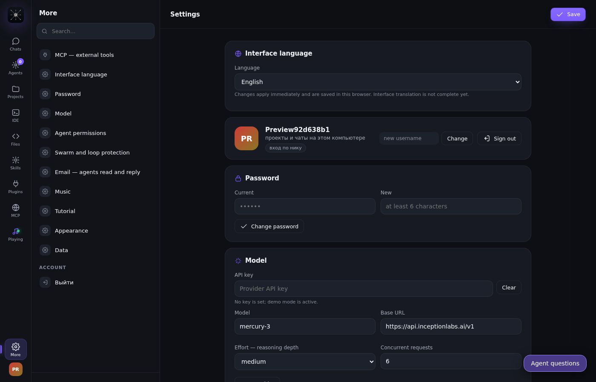

# MRCAgent

### Your workspace for conversations, coordinated AI agents and building projects

[Русский](#русский) · [English](#english) · [Download for Windows](https://gofile.io/d/NPFdiLKp) · [Video overview](https://gofile.io/d/r28H8uzs)

> Early preview. This public repository is the project information page; it does not contain the MRCAgent source code. The download link is hosted by a third party and may expire.

---

## English

**MRCAgent** brings chat, a team of digital agents and project tools into one workspace. **MRCIDE Studio** is its built-in project and build interface.

### What is inside

- **Chat and agents:** start a conversation, create a project and follow agent activity. Agents can ask questions and wait up to two minutes for a response.
- **MRCIDE Studio:** work with project files and check build options for Windows and Android; GitHub Actions workflows can be prepared. Platform support depends on the available tools and environment.
- **Provider choice:** configure a compatible model provider and its API key. Demo mode simulates responses without a provider key.
- **Voice input:** dictate into the chat, review the text, and send it yourself. Browser speech recognition support varies and may require internet access.
- **Local voice output:** play completed chat answers with the Russian Piper Ruslan voice on the computer. The requested anime voices are not included.
- **Language settings:** choose Russian or English under **More → Interface language**. Translation is currently partial; it does not translate chat messages or files.
- **Skills, plugins and MCP:** manage instructions and external tools. Only enable plugins and servers you trust; they can execute code or access the network.

### Try it

1. [Download the Windows x64 preview](https://gofile.io/d/NPFdiLKp) (about 106 MiB).
2. Run it on Windows. Windows may show a warning for an unsigned application.
3. Explore demo mode or configure your preferred provider in settings. Provider requests may incur charges.

The GitHub Actions build completed, and the browser-based language and voice tests ran on Linux. This version has **not been independently tested by us as an interactive Windows installation**. Audio input in WebView2 has not been verified. Please test on your own device and report issues.

**SHA-256:** `46c420a1ae9c48c85a67722ec7c420c7c008c134ca5f0519d610418098b93f26`

---

## Русский

**MRCAgent** объединяет переписку, команду цифровых агентов и инструменты для работы над проектами. **MRCIDE Studio** — встроенный интерфейс для файлов и сборок.

### Возможности

- **Чат и агенты:** создавайте задачи, наблюдайте за работой и отвечайте на вопросы агентов. Если ответа нет, агент ждёт до двух минут и продолжает самостоятельно.
- **MRCIDE Studio:** файлы проекта, проверка инструментов сборки для Windows и Android, подготовка workflow для GitHub Actions. Доступность зависит от окружения.
- **Выбор провайдера:** модель и API-ключ настраиваются пользователем. Демо-режим имитирует ответы без ключа.
- **Голосовой ввод:** диктовка в поле сообщения с возможностью проверить текст перед отправкой. Поддержка зависит от браузера, может понадобиться интернет.
- **Локальная озвучка:** готовый ответ можно послушать голосом Piper Руслан на компьютере. Выбранные аниме-голоса в этой версии не установлены.
- **Русский и английский:** переключатель находится в разделе **Ещё → Язык интерфейса**. Перевод пока частичный; сообщения и файлы не переводятся.
- **Скиллы, плагины и MCP:** инструкции и внешние инструменты для агентов. Включайте только доверенные плагины и серверы: они могут запускать программы и обращаться к сети.

### Попробовать

1. [Скачать предварительную версию для Windows x64](https://gofile.io/d/NPFdiLKp) (около 106 МиБ).
2. Запустить на Windows. Для приложения без цифровой подписи Windows может показать предупреждение.
3. Открыть демо-режим или настроить нужного провайдера. Запросы к провайдеру могут быть платными.

Сборка GitHub Actions завершилась успешно; интерфейс и озвучка проверялись тестами на Linux. **Интерактивный запуск этой версии на Windows лично не проверен**, работа микрофона в WebView2 тоже. Пожалуйста, проверяйте на своём устройстве.

---

### Third-party licenses / Лицензии компонентов

- `piper-tts` 1.8.0: [GPL-3.0-or-later](https://pypi.org/project/piper-tts/1.8.0/). Distribution may require providing corresponding source and other license compliance steps. The MRCAgent source is not published in this repository; compliance for this preview has not been independently verified.
- The [Ruslan model card](https://huggingface.co/rhasspy/piper-voices/blob/main/ru/ru_RU/ruslan/medium/MODEL_CARD) identifies its training dataset as [CC BY-NC-SA 4.0](https://creativecommons.org/licenses/by-nc-sa/4.0/). Check all applicable model and dataset terms before use or distribution, especially commercial use.

Piper 1.8.0 имеет лицензию GPL-3.0-or-later; публичное распространение может требовать предоставления соответствующих исходников. В этой странице исходники MRCAgent не опубликованы, соответствие условиям пока не проверено. Для данных голоса указан CC BY-NC-SA 4.0 — коммерческое использование требует отдельной проверки прав.
